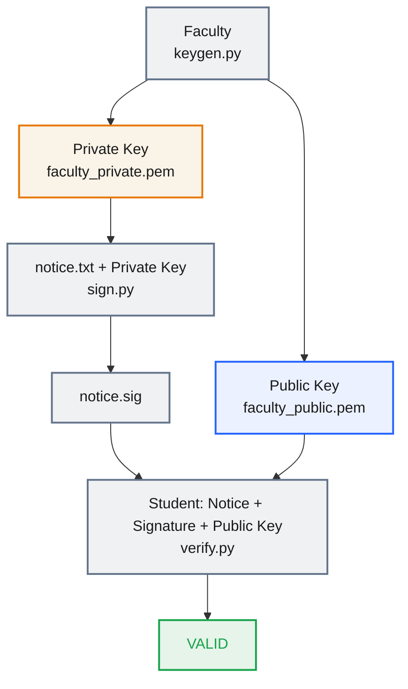

# What does the project do?

Assume an annoncement from the facult of UM:

```text
Official Faculty Notice

The final examination will be held at 9:00 AM.
All students must attend.
```

However, students how to know something when they received the annoncement:

- Are the announcement really from the faculty?
- Does the announcement be changed by the attacker?
- Does some one send the annoucement as a fake faculty officer?

We need use `Ed25519 Digital Signature` to solve those questions.

# Work Stream of Project



The faculty use the Private Key to signature on the announcement, and student use the Public Key to vertify the signature.

Notice: the digital signature is not a encryption method for the context. All the context could be read by other, but student can vertify the context if be changed by others.

# Attribution for the project

| Member | Assigned File | Main Task |
| --- | --- | --- |
| M1 | `attacker.py` | Simulate an attacker forging a digital signature |
| M1 | `fingerprint.py` | Verify the public key fingerprint |
| M2 | `keygen.py` | Generate Ed25519 public and private keys |
| M2 | `sign.py` | Sign the document using the private key |
| M3 | `notice.txt` | Create a simulated official notice |
| M3 | `requirements.txt` | Manage Python dependencies |
| M3 | `README.md` | Write a complete experiment runbook |
| M4 | `verify.py` | Implement digital signature verification |

# The function of the Python file

1. `keygen.py` - Key Generation

```bash
python keygen.py
```

To generate two files:

- faculty_private.pem
- faculty_public.pem

Private Key used to digital signature; Public Key used to vertify the message.

---

2. `sign,py` - Digital Signing

```bash
python sign.py notice.txt faculty_private.pem
```

Use the faculty private key to signature the `notice.txt`, generate `notce.sig`

---

3. `verify.py` - Signature Vertification

```bash
python verify,py notice.txt notice.sig faculty_public.pem
```

Check the annoucement, digital signature and public key if correct, and output the `VALID` or `INVALID`

---

4. `attacker.py` - Attack Simulation

```bash
python attacker.py notice_edited.txt
```

Simulate an attacker use their private key to change the digital signature, generate:

- `attacker_private.pem`
- `attacker_public.pem`
- `attacker.sig`

---

5. `fingerprint.py` - Public Key Fingerprint

```bash
python fingerprint.py faculty_public,pem
```

Use the SHA-256 generate the short public key fingerprint. Using the available fingerprint compare with the short public key fingerprint to check the public key if be changed.

# What we need to do?

### Experiment 1: Normal Digital Signature Vertification

Faculty signature the original annoucement, student use the public key to vertify

```bash
python keygen.py
python sign.py notice.txt faculty_private.pem
python verify.py notice.txt notice.sig faculty_public.pem
```

except output:

```text
VALID
```

### Experiment 2: Change the Original Data

Assume attacker change the examination date from 9:00 a.m to 3 p.m, and save the fake file as `notice_edited.txt`

```bash
python verify.py notice_edited.txt notice.sig faculty_public.pem
```

Except output:

```text
INVALID
```

Vertify the `Ed25519` can protect the Integrity

### Experiment 3: Attacker Generate their Own Digital Signature

Attacker can not use the private key, but they could generate their own private key, and signature the edited file.

```bash
python attacker.py notice_edited.txt
```

Firstly, attacker use the faculty public key to vertify:

```bash
python verify.py notice_edited.txt attacker.sig faculty_public.pem
```

Except output: `INVALID`

Then attacker use their own generate public key to vertify:

```bash
python verify.py notice_edited.txt attacker.sig attacker_public.pem
```

Except output: `VALID`

This is an important thing: Vertification Successful is not means that the message really from the UM, we need to make sure the public key is from the UM

### Experiment 4: Check the Public Key Fingerprint

```bash
python fingerprint.py faculty_public.pem
python fingerprint.py attacker_public.pem
```

Compare two different public key fingerprint, and illustrate how to ensure the UM public key by using a vaild method

Only compare the public key fingerprint with the correct public key fingerprint, to recoginize the change the public key attacke.